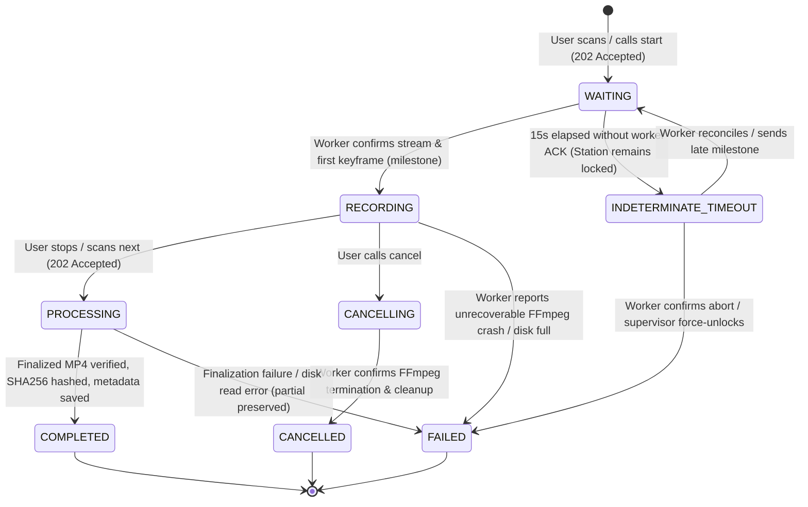

# PACKING VIDEO PROOF - SYSTEM ARCHITECTURE SPECIFICATION

> **Document Version:** 2.2.0 (Post Codex R1 Review - Findings D01-01, D01-02, D01-06 Addressed)  
> **Status:** Architecture Baseline Specification  
> **Scope:** On-Premises LAN-First Packing Proof System

---

## 1. Executive Summary & Design Principles

**PACKING VIDEO PROOF** is an enterprise-grade, fail-safe video recording and forensic audit system designed for warehouse fulfillment hubs, 3PL providers, and e-commerce operators (Shopee, TikTok Shop, Lazada).

### Core Architectural Principles

1. **LAN-First Sovereignty (Zero Cloud Dependency):**
   - Core fulfillment operations (barcode scanning, camera stream ingestion, local storage, verification) function with zero external internet connectivity.
   - Server and station communication occurs strictly over local LAN infrastructure.
2. **Fail-Safe Video Ingestion Pipeline (Never Record Directly to Network Shares):**
   - Active recordings **never** stream directly to SMB/NAS storage due to transient network latency, SMB locks, and packet loss risks.
   $$\text{Camera} \xrightarrow{\text{RTSP/UVC}} \text{Worker Process} \xrightarrow{\text{Direct I/O}} \text{Local SSD Temp (fMP4)} \xrightarrow{\text{Finalize + SHA256}} \text{Local Primary Archive} \xrightarrow{\text{Async Verified Queue}} \text{NAS / SMB Share}$$
3. **Container Crash-Resilience (Fragmented MP4 Ingestion):**
   - Standard MP4 stores its metadata index (`moov` atom) at the end of the file. Sudden power cuts or OS crashes destroy unfinalized MP4s.
   - The ingestion pipeline records to **Fragmented MP4 (fMP4)** via `-f mp4` with `-movflags empty_moov+default_base_moof+frag_keyframe`. If power cuts mid-recording, all flushed fragments up to the last keyframe are preserved on disk and readable without `moov` atom corruption.
   - The finalization step remuxes the file to standard web-optimized MP4 (`+faststart`) into a dedicated temp file before an atomic move to the permanent archive path.
4. **Strict Concurrency Protection & Lease Model (D01-01):**
   - One packing station and one camera can execute **at most one active recording session** at any time.
   - Timeouts in communication do **not** automatically release the station lock while worker processes may still be running.
   - The station lock is maintained until either the worker confirms termination, an explicit state reconciliation handshake completes, or a supervisor issues an authenticated force-unlock.
5. **Decoupled Architecture & Role Boundaries:**
   - **Admin Web:** Management, configuration, audit, video search (no direct DB or filesystem access).
   - **User Web:** Scanning, session status display, operator triggers (no local recording logic).
   - **Backend API:** Central business authority, RBAC, transactional outbox coordinator, metadata manager.
   - **Video Worker:** Host-level camera driver, FFmpeg supervisor, local SSD manager, NAS sync worker.

---

## 2. High-Level System Architecture Diagram

```
+----------------------------------------------------------------------------------------------------+
|                                    PACKING VIDEO PROOF WAREHOUSE LAN                                |
+----------------------------------------------------------------------------------------------------+
|                                                                                                    |
|    +-----------------------------+                           +--------------------------------+     |
|    |      ADMIN WEB (Vite/React) |                           |     USER WEB (Vite/React)      |     |
|    |  - Warehouse/Station Config |                           |  - Packing Station Screen      |     |
|    |  - Video Search & Proof     |                           |  - USB Scanner (HID Keyboard)  |     |
|    |  - Retention & Dispute Lock |                           |  - Giant State & Timer (2m)    |     |
|    +--------------+--------------+                           +---------------+----------------+     |
|                   |                                                          |                      |
|                   | HTTPS (REST API / JWT)                                   | HTTPS / WSS          |
|                   v                                                          v                      |
|    +------------------------------------------------------------------------------------------+     |
|    |                             BACKEND API SERVER (Fastify + TypeScript)                     |     |
|    |  - Multi-Warehouse RBAC (Argon2 / JWT)       - Barcode Validation Engine                 |     |
|    |  - Transactional Outbox & Inbox Dedup        - Session State Machine (Lease + OCC)       |     |
|    |  - Worker Dispatcher Gateway (WSS)           - Video Streaming Range Proxy (HTTP 206)    |     |
|    +----------------------------+---------------------------------------------+---------------+     |
|                                 |                                             |                     |
|            PostgreSQL Connection|Pool                                      WSS|Reverse Tunnel       |
|            (Conditional Indexes)|                                  (Auth Token|& Heartbeat 10s)     |
|                                 v                                             v                     |
|    +----------------------------+---------+          +------------------------+---------------+     |
|    |          POSTGRESQL 16               |          |       VIDEO WORKER (STATION PC)        |     |
|    |  - Business, Warehouses, Stations    |          |  - Node.js Daemon (Agent Service)      |     |
|    |  - Packing Sessions (Conditional UQ) |          |  - Persistent WSS Client to Backend    |     |
|    |  - Video Metadata & SHA-256 Hashes   |          |  - Local Command & Event Journal       |     |
|    |  - Transactional Outbox & Inbox      |          |  - FFmpeg Supervisor (fMP4 Ingestion)  |     |
|    +--------------------------------------+          |  - SHA-256 Stream Hasher & NAS Queue   |     |
|                                                      +-----+--------------------+-------------+     |
|                                                            |                    |                   |
|                                     RTSP TCP / DirectShow  |                    | Atomic Move & SMB |
|                                                            v                    v                   |
|                                                +-----------+--+     +-----------+-------------+     |
|                                                | CAMERAS      |     | STORAGE SUB-SYSTEM      |     |
|                                                | - RTSP H.264 |     | 1. Local Temp (D:\Temp) |     |
|                                                | - USB Webcams|     | 2. Local Final (D:\Vid) |     |
|                                                +--------------+     | 3. NAS Share (\\NAS\Vid)|     |
|                                                                     +-------------------------+     |
+----------------------------------------------------------------------------------------------------+
```

---

## 3. Communication Topology & Network Contracts

### 3.1. Topology Architecture
1. **Central Server Node (`192.168.1.10`):** Runs PostgreSQL, Backend API, and Nginx reverse proxy.
2. **Station Packing PCs (`192.168.1.51...70`):** Windows 10/11 PCs with USB Barcode Scanners, connected to USB Webcams or local PoE RTSP cameras.
3. **NAS / Storage Server (`192.168.1.15`):** High-capacity redundant array hosting Windows SMB Share `\\SERVER\PackingVideo`.

### 3.2. Worker-to-Backend Reverse Tunnel (Agent Pattern)
To eliminate fragile inbound routing to station PCs (DHCP IP changes, Windows firewall blocks, NAT):
- Each Video Worker initializes a persistent **WebSocket connection** (`wss://<server-ip>:4000/ws/worker`) upon boot.
- The connection is authenticated using a per-station cryptographically generated `X-Worker-Token`.
- **Worker Identity & Epoch (D01-01):** Each worker connection session generates a unique `workerEpoch` (UUID). All subsequent messages include this epoch. If a worker disconnects and reconnects, a new epoch is generated, instantly invalidating stale in-flight messages from prior connections.
- **Heartbeat & Dead-man Detection:** Worker transmits a telemetry heartbeat every 10 seconds. If Backend misses heartbeats for $> 30$ seconds, the worker status transitions to `SUSPECTED_OFFLINE`. Crucially, this does **not** assume the camera has stopped; the station remains marked `BUSY_UNREACHABLE` until state reconciliation.

### 3.3. Remote Video Playback Architecture (D01-06)
When an administrator in Admin Web requests to view a video:
- **Case 1: Video is `SYNCED` to NAS (Default / Standard):** Backend API streams the file directly from the local NAS mount path (`\\SERVER\PackingVideo\...`) using HTTP 206 Partial Content range requests.
- **Case 2: Video is still `LOCAL` (pending NAS sync):**
  - To preserve the strict outbound-only firewall posture of station PCs without exposing inbound station HTTP ports, the Backend requests the video chunk via an internal worker transfer stream over the authenticated WebSocket data channel, OR the Worker pushes completed videos directly to the Backend server's temporary preview cache upon finalize.
  - If NAS is unreachable and the video is only on a station PC that is currently offline, Backend returns `503 SERVICE_UNAVAILABLE` with error code `VIDEO_TEMPORARILY_OFFLINE_ON_STATION`.

---

## 4. State Machine & Idempotency Rules

### 4.1. Formal Session State Transitions (D01-01, D01-05)


### 4.2. Concurrency & Idempotency Rules
1. **Idempotency Key Enforcement:** Every mutation (`start`, `stop`, `cancel`) requires an `Idempotency-Key` header (UUIDv4) scoped to `(business_id, warehouse_id, route_path, idempotency_key)`.
   - Matching fingerprint: Returns cached response.
   - Mismatched fingerprint: Returns `409 Conflict` (`IDEMPOTENCY_PAYLOAD_MISMATCH`).
2. **Single Active Session Constraint:**
   - Enforced at DB level: `CREATE UNIQUE INDEX uq_active_station_session ON packing_sessions (station_id) WHERE status IN ('WAITING', 'RECORDING', 'PROCESSING', 'INDETERMINATE_TIMEOUT', 'CANCELLING');`
   - Prevents starting any new session while a prior recording is active or in an unverified state.
