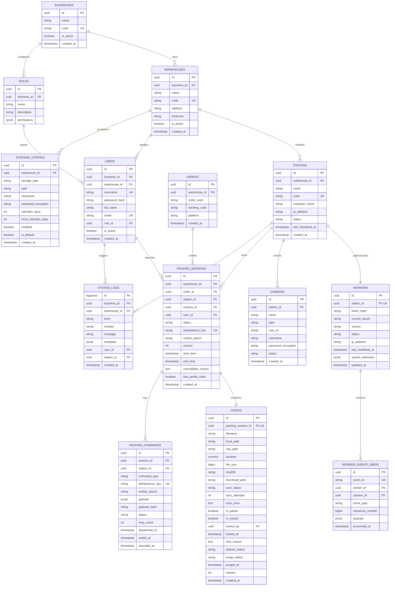

# PACKING VIDEO PROOF - DATABASE SCHEMA SPECIFICATION

> **Document Version:** 2.2.0 (Post Codex R1 Review - Findings D01-01, D01-02, D01-03, D01-05, D01-08 Addressed)  
> **Target RDBMS:** PostgreSQL 15+  
> **ORM Engine:** Prisma ORM / Drizzle ORM

---

## 1. Entity-Relationship Overview & Boundary Scoping



---

## 2. PostgreSQL DDL Specification

```sql
-- Extensions
CREATE EXTENSION IF NOT EXISTS "uuid-ossp";
CREATE EXTENSION IF NOT EXISTS "pgcrypto";

-- 1. BUSINESSES (Multi-warehouse / Tenant Foundation)
CREATE TABLE businesses (
    id UUID PRIMARY KEY DEFAULT gen_random_uuid(),
    name VARCHAR(100) NOT NULL,
    code VARCHAR(50) NOT NULL UNIQUE,
    is_active BOOLEAN NOT NULL DEFAULT TRUE,
    created_at TIMESTAMPTZ NOT NULL DEFAULT CURRENT_TIMESTAMP,
    updated_at TIMESTAMPTZ NOT NULL DEFAULT CURRENT_TIMESTAMP
);

-- 2. ROLES
CREATE TABLE roles (
    id UUID PRIMARY KEY DEFAULT gen_random_uuid(),
    business_id UUID NOT NULL REFERENCES businesses(id) ON DELETE CASCADE,
    name VARCHAR(50) NOT NULL,
    description VARCHAR(255),
    permissions JSONB NOT NULL DEFAULT '[]'::jsonb,
    created_at TIMESTAMPTZ NOT NULL DEFAULT CURRENT_TIMESTAMP,
    CONSTRAINT uq_role_business_name UNIQUE (business_id, name)
);

-- 3. WAREHOUSES
CREATE TABLE warehouses (
    id UUID PRIMARY KEY DEFAULT gen_random_uuid(),
    business_id UUID NOT NULL REFERENCES businesses(id) ON DELETE CASCADE,
    name VARCHAR(100) NOT NULL,
    code VARCHAR(50) NOT NULL UNIQUE,
    address TEXT,
    timezone VARCHAR(50) NOT NULL DEFAULT 'Asia/Ho_Chi_Minh',
    is_active BOOLEAN NOT NULL DEFAULT TRUE,
    created_at TIMESTAMPTZ NOT NULL DEFAULT CURRENT_TIMESTAMP,
    updated_at TIMESTAMPTZ NOT NULL DEFAULT CURRENT_TIMESTAMP
);

-- 4. USERS
CREATE TABLE users (
    id UUID PRIMARY KEY DEFAULT gen_random_uuid(),
    business_id UUID NOT NULL REFERENCES businesses(id) ON DELETE CASCADE,
    warehouse_id UUID REFERENCES warehouses(id) ON DELETE SET NULL,
    username VARCHAR(50) NOT NULL UNIQUE,
    password_hash VARCHAR(255) NOT NULL,
    full_name VARCHAR(100) NOT NULL,
    email VARCHAR(100) NOT NULL UNIQUE,
    role_id UUID NOT NULL REFERENCES roles(id) ON DELETE RESTRICT,
    is_active BOOLEAN NOT NULL DEFAULT TRUE,
    created_at TIMESTAMPTZ NOT NULL DEFAULT CURRENT_TIMESTAMP,
    updated_at TIMESTAMPTZ NOT NULL DEFAULT CURRENT_TIMESTAMP,
    CONSTRAINT uq_user_id_warehouse UNIQUE (id, warehouse_id)
);

-- 5. STATIONS
CREATE TABLE stations (
    id UUID PRIMARY KEY DEFAULT gen_random_uuid(),
    warehouse_id UUID NOT NULL REFERENCES warehouses(id) ON DELETE CASCADE,
    name VARCHAR(100) NOT NULL,
    code VARCHAR(50) NOT NULL UNIQUE,
    computer_name VARCHAR(100),
    ip_address VARCHAR(45),
    status VARCHAR(30) NOT NULL DEFAULT 'OFFLINE', -- OFFLINE, ONLINE, BUSY, SUSPECTED_OFFLINE, MAINTENANCE
    last_heartbeat_at TIMESTAMPTZ,
    created_at TIMESTAMPTZ NOT NULL DEFAULT CURRENT_TIMESTAMP,
    updated_at TIMESTAMPTZ NOT NULL DEFAULT CURRENT_TIMESTAMP,
    CONSTRAINT uq_station_id_warehouse UNIQUE (id, warehouse_id)
);

-- 6. WORKERS (Daemon Registration & Token Auth)
CREATE TABLE workers (
    id UUID PRIMARY KEY DEFAULT gen_random_uuid(),
    station_id UUID NOT NULL UNIQUE REFERENCES stations(id) ON DELETE CASCADE,
    token_hash VARCHAR(255) NOT NULL,
    current_epoch UUID, -- Generated per connection to invalidate stale messages (D01-01)
    version VARCHAR(30) NOT NULL DEFAULT '1.0.0',
    status VARCHAR(30) NOT NULL DEFAULT 'OFFLINE',
    ip_address VARCHAR(45),
    last_heartbeat_at TIMESTAMPTZ,
    system_telemetry JSONB,
    created_at TIMESTAMPTZ NOT NULL DEFAULT CURRENT_TIMESTAMP,
    updated_at TIMESTAMPTZ NOT NULL DEFAULT CURRENT_TIMESTAMP
);

-- 7. CAMERAS
CREATE TABLE cameras (
    id UUID PRIMARY KEY DEFAULT gen_random_uuid(),
    station_id UUID NOT NULL REFERENCES stations(id) ON DELETE CASCADE,
    name VARCHAR(100) NOT NULL,
    type VARCHAR(20) NOT NULL DEFAULT 'RTSP', -- 'RTSP' or 'WEBCAM'
    rtsp_url TEXT,
    username VARCHAR(100),
    password_encrypted TEXT,
    status VARCHAR(30) NOT NULL DEFAULT 'OFFLINE',
    created_at TIMESTAMPTZ NOT NULL DEFAULT CURRENT_TIMESTAMP,
    updated_at TIMESTAMPTZ NOT NULL DEFAULT CURRENT_TIMESTAMP,
    CONSTRAINT uq_camera_id_station UNIQUE (id, station_id)
);

-- 8. ORDERS (Scoped by Warehouse)
CREATE TABLE orders (
    id UUID PRIMARY KEY DEFAULT gen_random_uuid(),
    warehouse_id UUID NOT NULL REFERENCES warehouses(id) ON DELETE CASCADE,
    order_code VARCHAR(100) NOT NULL,
    tracking_code VARCHAR(100) NOT NULL,
    platform VARCHAR(50) NOT NULL DEFAULT 'OTHER',
    customer_info JSONB,
    created_at TIMESTAMPTZ NOT NULL DEFAULT CURRENT_TIMESTAMP,
    CONSTRAINT uq_orders_warehouse_tracking UNIQUE (warehouse_id, tracking_code)
);

-- 9. PACKING SESSIONS (State Machine + Concurrency Protection)
CREATE TABLE packing_sessions (
    id UUID PRIMARY KEY DEFAULT gen_random_uuid(),
    warehouse_id UUID NOT NULL REFERENCES warehouses(id) ON DELETE RESTRICT,
    order_id UUID NOT NULL REFERENCES orders(id) ON DELETE RESTRICT,
    station_id UUID NOT NULL REFERENCES stations(id) ON DELETE RESTRICT,
    camera_id UUID NOT NULL REFERENCES cameras(id) ON DELETE RESTRICT,
    user_id UUID NOT NULL REFERENCES users(id) ON DELETE RESTRICT,
    status VARCHAR(30) NOT NULL DEFAULT 'WAITING', -- WAITING, RECORDING, PROCESSING, COMPLETED, FAILED, CANCELLING, CANCELLED, INDETERMINATE_TIMEOUT
    idempotency_key VARCHAR(100) UNIQUE,
    worker_epoch UUID,
    version INT NOT NULL DEFAULT 1,
    start_time TIMESTAMPTZ NOT NULL DEFAULT CURRENT_TIMESTAMP,
    end_time TIMESTAMPTZ,
    cancellation_reason TEXT,
    has_partial_video BOOLEAN NOT NULL DEFAULT FALSE,
    created_at TIMESTAMPTZ NOT NULL DEFAULT CURRENT_TIMESTAMP,
    updated_at TIMESTAMPTZ NOT NULL DEFAULT CURRENT_TIMESTAMP,
    -- Enforce cross-table warehouse boundary (D01-08)
    CONSTRAINT fk_session_station_warehouse FOREIGN KEY (station_id, warehouse_id) REFERENCES stations(id, warehouse_id),
    CONSTRAINT fk_session_user_warehouse FOREIGN KEY (user_id, warehouse_id) REFERENCES users(id, warehouse_id)
);

-- 10. PACKING COMMANDS (Transactional Outbox)
CREATE TABLE packing_commands (
    id UUID PRIMARY KEY DEFAULT gen_random_uuid(),
    session_id UUID NOT NULL REFERENCES packing_sessions(id) ON DELETE CASCADE,
    station_id UUID NOT NULL REFERENCES stations(id) ON DELETE CASCADE,
    command_type VARCHAR(50) NOT NULL, -- START_RECORD, STOP_RECORD, CANCEL_RECORD
    idempotency_key VARCHAR(100) NOT NULL UNIQUE,
    worker_epoch UUID,
    payload JSONB NOT NULL,
    payload_hash VARCHAR(64) NOT NULL,
    status VARCHAR(30) NOT NULL DEFAULT 'PENDING', -- PENDING, DISPATCHED, ACKED, EXECUTED, FAILED
    retry_count INT NOT NULL DEFAULT 0,
    error_message TEXT,
    created_at TIMESTAMPTZ NOT NULL DEFAULT CURRENT_TIMESTAMP,
    dispatched_at TIMESTAMPTZ,
    acked_at TIMESTAMPTZ,
    executed_at TIMESTAMPTZ
);

-- 11. WORKER EVENTS INBOX (Backend Deduplication Journal - D01-02)
CREATE TABLE worker_events_inbox (
    id UUID PRIMARY KEY DEFAULT gen_random_uuid(),
    event_id VARCHAR(100) NOT NULL UNIQUE,
    worker_id UUID NOT NULL REFERENCES workers(id) ON DELETE CASCADE,
    session_id UUID REFERENCES packing_sessions(id) ON DELETE CASCADE,
    event_type VARCHAR(50) NOT NULL,
    sequence_number BIGINT NOT NULL,
    payload JSONB NOT NULL,
    processed_at TIMESTAMPTZ NOT NULL DEFAULT CURRENT_TIMESTAMP
);

-- 12. VIDEOS (Forensic Proof & Retention Tracking)
CREATE TABLE videos (
    id UUID PRIMARY KEY DEFAULT gen_random_uuid(),
    packing_session_id UUID NOT NULL UNIQUE REFERENCES packing_sessions(id) ON DELETE CASCADE,
    filename VARCHAR(255) NOT NULL,
    local_path TEXT NOT NULL,
    nas_path TEXT,
    duration NUMERIC(8,2) NOT NULL DEFAULT 0.0,
    file_size BIGINT NOT NULL DEFAULT 0,
    sha256 VARCHAR(64) NOT NULL,
    thumbnail_path TEXT,
    sync_status VARCHAR(30) NOT NULL DEFAULT 'LOCAL', -- LOCAL, PENDING, SYNCING, SYNCED, FAILED
    sync_attempts INT NOT NULL DEFAULT 0,
    sync_error TEXT,
    is_partial BOOLEAN NOT NULL DEFAULT FALSE,
    is_locked BOOLEAN NOT NULL DEFAULT FALSE,
    locked_by UUID REFERENCES users(id) ON DELETE SET NULL,
    locked_at TIMESTAMPTZ,
    lock_reason TEXT,
    dispute_status VARCHAR(30) NOT NULL DEFAULT 'NORMAL', -- NORMAL, DISPUTE, RESOLVED
    purge_status VARCHAR(30) NOT NULL DEFAULT 'ACTIVE', -- ACTIVE, PENDING_PURGE, PURGED (D01-03)
    purged_at TIMESTAMPTZ,
    version INT NOT NULL DEFAULT 1,
    created_at TIMESTAMPTZ NOT NULL DEFAULT CURRENT_TIMESTAMP,
    updated_at TIMESTAMPTZ NOT NULL DEFAULT CURRENT_TIMESTAMP
);

-- 13. STORAGE CONFIGS
CREATE TABLE storage_configs (
    id UUID PRIMARY KEY DEFAULT gen_random_uuid(),
    warehouse_id UUID NOT NULL REFERENCES warehouses(id) ON DELETE CASCADE,
    storage_type VARCHAR(50) NOT NULL, -- LOCAL_TEMP, LOCAL_ARCHIVE, NAS_SHARE
    path TEXT NOT NULL,
    username VARCHAR(100),
    password_encrypted TEXT,
    retention_days INT NOT NULL DEFAULT 90,
    local_retention_days INT NOT NULL DEFAULT 14,
    enabled BOOLEAN NOT NULL DEFAULT TRUE,
    is_default BOOLEAN NOT NULL DEFAULT FALSE,
    created_at TIMESTAMPTZ NOT NULL DEFAULT CURRENT_TIMESTAMP,
    updated_at TIMESTAMPTZ NOT NULL DEFAULT CURRENT_TIMESTAMP
);

-- 14. SYSTEM LOGS
CREATE TABLE system_logs (
    id BIGSERIAL PRIMARY KEY,
    business_id UUID REFERENCES businesses(id) ON DELETE CASCADE,
    warehouse_id UUID REFERENCES warehouses(id) ON DELETE CASCADE,
    level VARCHAR(20) NOT NULL,
    module VARCHAR(50) NOT NULL,
    message TEXT NOT NULL,
    metadata JSONB,
    user_id UUID REFERENCES users(id) ON DELETE SET NULL,
    station_id UUID REFERENCES stations(id) ON DELETE SET NULL,
    created_at TIMESTAMPTZ NOT NULL DEFAULT CURRENT_TIMESTAMP
);
```

---

## 3. Strict Concurrency & Partial Unique Constraints

```sql
-- RULE 1: STRICT SINGLE ACTIVE SESSION PER STATION (D01-01)
-- Maintains lock across WAITING, RECORDING, PROCESSING, CANCELLING, and INDETERMINATE_TIMEOUT
CREATE UNIQUE INDEX uq_active_station_session 
ON packing_sessions (station_id) 
WHERE status IN ('WAITING', 'RECORDING', 'PROCESSING', 'CANCELLING', 'INDETERMINATE_TIMEOUT');

-- RULE 2: STRICT SINGLE ACTIVE SESSION PER CAMERA (D01-01)
CREATE UNIQUE INDEX uq_active_camera_session 
ON packing_sessions (camera_id) 
WHERE status IN ('WAITING', 'RECORDING', 'PROCESSING', 'CANCELLING', 'INDETERMINATE_TIMEOUT');

-- RULE 3: FAST INDEX FOR PENDING NAS SYNC QUEUE
CREATE INDEX idx_videos_sync_queue 
ON videos (created_at ASC) 
WHERE sync_status IN ('PENDING', 'FAILED', 'SYNCING');

-- RULE 4: FAST SEARCH BY TRACKING AND ORDER CODES
CREATE INDEX idx_orders_warehouse_tracking ON orders (warehouse_id, tracking_code);
CREATE INDEX idx_orders_order_code ON orders (order_code);

-- RULE 5: RETENTION SWEEP INDEX (D01-03)
CREATE INDEX idx_videos_retention_candidates 
ON videos (created_at ASC) 
WHERE is_locked = FALSE 
  AND dispute_status = 'NORMAL' 
  AND purge_status = 'ACTIVE' 
  AND sync_status = 'SYNCED';
```

---

## 4. Retention & Dispute Race-Condition Prevention (D01-03)

To eliminate the race condition where a background retention cron deletes a video while CSKH concurrently applies a dispute lock:

### Two-Phase Deletion Protocol
```sql
-- STEP 1: TRANSACTIONAL INTENT (Mark PENDING_PURGE with Row Locks)
BEGIN;

SELECT id, local_path, nas_path, sync_status 
FROM videos 
WHERE created_at < (NOW() - (SELECT retention_days FROM storage_configs WHERE warehouse_id = videos.warehouse_id AND storage_type = 'NAS_SHARE' LIMIT 1) * INTERVAL '1 day')
  AND is_locked = FALSE 
  AND dispute_status = 'NORMAL'
  AND purge_status = 'ACTIVE'
  AND sync_status = 'SYNCED'
FOR UPDATE SKIP LOCKED;

-- If rows selected, update purge_status immediately inside transaction:
UPDATE videos 
SET purge_status = 'PENDING_PURGE', updated_at = NOW() 
WHERE id = :candidate_id;

COMMIT;

-- STEP 2: PHYSICAL REMOVAL (File operations on Local Archive and NAS)
-- Worker / Cleanup Daemon verifies file deletion.

-- STEP 3: FINALIZATION
UPDATE videos 
SET purge_status = 'PURGED', purged_at = NOW(), updated_at = NOW() 
WHERE id = :candidate_id;
```

**Dispute Lock Guard:**
When CSKH calls `PATCH /api/v1/videos/:id/dispute`:
```sql
-- Attempting to lock a video that is in PENDING_PURGE or PURGED returns 409 Conflict:
UPDATE videos 
SET is_locked = TRUE, dispute_status = 'DISPUTE', locked_by = :userId, locked_at = NOW(), lock_reason = :reason
WHERE id = :videoId AND purge_status = 'ACTIVE';

-- If rows_affected == 0: API returns 409 Conflict: VIDEO_ALREADY_PURGED_OR_PURGE_IN_PROGRESS.
```
