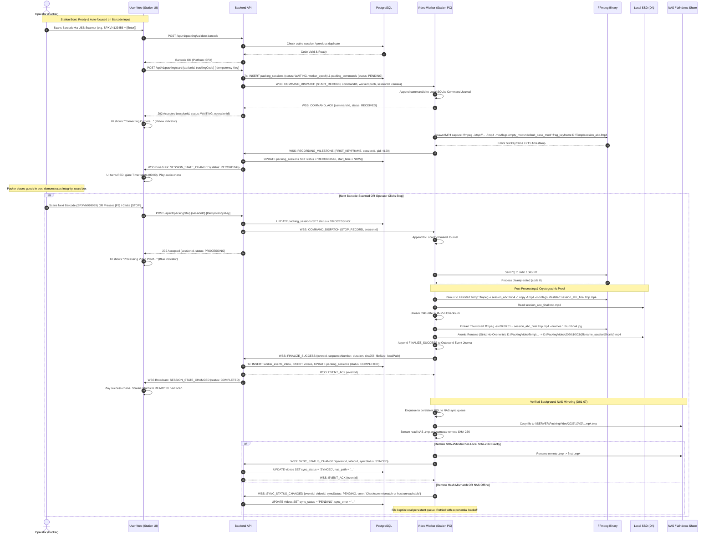

# PACKING VIDEO PROOF - DETAILED PACKING & RECORDING LIFECYCLE

> **Document Version:** 2.2.0 (Post Codex R1 Review - Findings D01-01, D01-02, D01-03, D01-04, D01-07 Addressed)  
> **Topic:** Packing Station Operational Flows, Anti-Mistake Scenarios & Fail-Safe Recording Pipeline

---

## 1. End-to-End Operational Sequence

---

## 2. Chi Tiết Các Luồng Nghiệp Vụ Chính

---

### Luồng 1: Bắt đầu phiên quay đóng gói (Start Recording Flow) (D01-01, D01-02)

- **Đầu vào (Inputs):**
  - `stationId`: UUID của trạm đóng gói.
  - `trackingCode`: Mã vận đơn đã chuẩn hóa.
  - `orderCode`: Mã đơn hàng nội bộ.
  - `platform`: `SPX`, `TIKTOK`, `LAZADA`, `GHN`, `GHTK`, `VIETTEL_POST`, `JT`, `OTHER`.
  - `Idempotency-Key`: UUIDv4.
  - `forceOverridePrevious`: Boolean.
- **Điều kiện tiên quyết (Prerequisites):**
  - Operator đã đăng nhập; `user.warehouse_id === station.warehouse_id`.
  - Station đang ở trạng thái `ONLINE`.
  - Không có phiên nào trên trạm hoặc camera ở trạng thái `WAITING`, `RECORDING`, `PROCESSING`, `CANCELLING`, hoặc `INDETERMINATE_TIMEOUT` (bảo vệ bởi `uq_active_station_session`).
  - Dung lượng trống ổ SSD `D:\PackingVideoTemp` $\ge 2$ GB.
- **Kết quả mong đợi (Expected Results):**
  - Database tạo `packing_sessions` (`status = 'WAITING'`) và `packing_commands` (`status = 'PENDING'`) trong cùng 1 transaction.
  - Backend trả về `202 Accepted` với payload `{sessionId, operationId, status: "WAITING"}`.
  - Video Worker ghi command vào Local Command Journal (SQLite), phản hồi `COMMAND_ACK`, khởi chạy FFmpeg `fMP4`.
  - Khi nhận keyframe đầu tiên, Worker gửi `RECORDING_MILESTONE`, Backend chuyển sang `RECORDING`. Màn hình trạm chuyển ĐỎ, Timer bắt đầu chạy.
- **Nhánh lỗi & Khắc phục Timeout (D01-01):**
  - *Lỗi Timeout 15s:* Nếu sau 15 giây không nhận được `RECORDING_MILESTONE`, Backend chuyển trạng thái sang `INDETERMINATE_TIMEOUT`.
  - **Trạm KHÔNG được tự động giải phóng:** Station tiếp tục bị khóa để ngăn công nhân bấm quay đè khi FFmpeg có thể đang chạy ngầm. Trạm chỉ mở lại khi:
    1. Worker kết nối lại và gửi báo cáo trạng thái xác nhận tiến trình đã tắt.
    2. Hoặc Trưởng kho thực hiện lệnh `POST /api/v1/stations/:id/force-unlock` sau khi kiểm tra thực tế.
- **Tiêu chí kiểm thử (Acceptance Criteria):**
  - [TC-START-01] Gửi 2 request Start đồng thời $\rightarrow$ Đúng 1 request nhận `202 Accepted`, request thứ hai nhận `409 Conflict`.
  - [TC-START-02] Mất mạng ngay sau khi gửi lệnh Start $\rightarrow$ Sau 15s session chuyển `INDETERMINATE_TIMEOUT`, mọi yêu cầu Start mới trên trạm đó đều bị chặn cho đến khi đối chiếu trạng thái.

---

### Luồng 2: Dừng quay & Hoàn tất đóng gói (Stop & Finalize Flow) (D01-02, D01-04)

- **Đầu vào:** `sessionId`, `Idempotency-Key`.
- **Điều kiện:** Phiên đang ở `RECORDING`.
- **Kết quả mong đợi:**
  - Backend cập nhật session sang `PROCESSING`, trả `202 Accepted`.
  - Worker gửi `q` vào FFmpeg. Sau khi tiến trình thoát, remux tệp `.fmp4` sang `session_{id}_final.tmp.mp4` (`-c copy -f mp4 -movflags +faststart`).
  - Worker tính SHA-256 trực tiếp từ file final.
  - Worker trích xuất thumbnail JPEG tại 00:00:01.
  - Atomic rename sang `D:\PackingVideo\YYYY\MM\DD\{tracking}_{station}_{timestamp}_{sessionShortId}.mp4` (tuyệt đối không ghi đè file có sẵn).
  - Worker ghi `FINALIZE_SUCCESS` vào Outbound Journal, gửi về Backend.
  - Backend cập nhật `videos` và `packing_sessions` (`status = 'COMPLETED'`).
- **Tiêu chí kiểm thử:**
  - [TC-STOP-01] Tên file video tạo ra chứa mã session short ID, không bao giờ bị ghi đè dù có 2 lần finalize cùng mã vận đơn.

---

### Luồng 4: Đồng bộ NAS & Xác minh toàn vẹn (Verified NAS Mirroring) (D01-07)

- **Đầu vào:** Video cục bộ đã finalized, `sync_status = 'PENDING'`.
- **Kết quả mong đợi:**
  - Worker copy video sang tệp tạm trên NAS: `\\SERVER\PackingVideo\YYYY\MM\DD\{filename}.mp4.tmp`.
  - Worker stream đọc tệp trên NAS và tính mã băm SHA-256 từ xa.
  - **Chỉ khi `nas_sha256 === local_sha256`:** Worker mới đổi tên tệp trên NAS thành `{filename}.mp4` và gửi `SYNC_STATUS_CHANGED` (`syncStatus: 'SYNCED'`).
  - Nếu mã băm không khớp hoặc mất kết nối: Tệp tạm trên NAS bị xóa, trạng thái giữ là `PENDING`, hàng đợi SQLite lưu job để retry với backoff. Bản local tuyệt đối không bị xóa.
- **Tiêu chí kiểm thử:**
  - [TC-NAS-HASH-01] Giả lập truyền file hỏng (thay đổi 1 byte giữa chừng) $\rightarrow$ Worker phát hiện hash không khớp, từ chối công bố `SYNCED`, báo lỗi `CHECKSUM_MISMATCH`, giữ nguyên file local an toàn.

---

### Luồng 6: Quản lý tranh chấp khiếu nại & Quét dọn Retention (D01-03)

- **Đầu vào:** Daily Retention Cron hoặc CSKH gọi `PATCH /videos/:id/dispute`.
- **Quy trình Hai Pha (Two-Phase Intent):**
  1. *Pha 1 (Ý định DB):* Cron mở transaction với `FOR UPDATE SKIP LOCKED`, chọn các video quá hạn, `is_locked = FALSE`, `dispute_status = 'NORMAL'`, `sync_status = 'SYNCED'`. Cập nhật `purge_status = 'PENDING_PURGE'`, commit.
  2. *Pha 2 (Xóa tệp vật lý):* Daemon xóa file trên Local SSD và NAS.
  3. *Pha 3 (Hoàn tất):* Cập nhật `purge_status = 'PURGED'`, `purged_at = NOW()`.
- **Bảo vệ Tranh chấp CSKH:**
  - Nếu CSKH bấm Khóa tranh chấp khi video đang ở `PENDING_PURGE` hoặc `PURGED`: Hệ thống trả về `409 Conflict` (`VIDEO_ALREADY_PURGED_OR_PURGE_IN_PROGRESS`), không bao giờ báo thành công giả tạo cho video đã bị xóa.
- **Tiêu chí kiểm thử:**
  - [TC-RET-01] Chạy đồng thời yêu cầu Dispute Lock của CSKH và Retention Purge $\rightarrow$ Nếu Cron chọn video trước thì CSKH nhận `409`, nếu CSKH khóa trước thì Cron bỏ qua không xóa.
