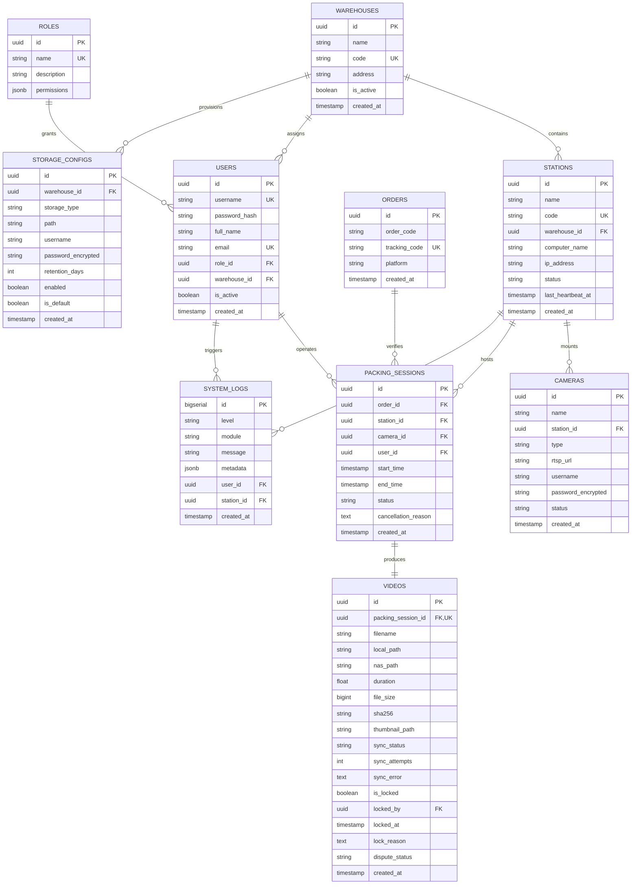

# PACKING VIDEO PROOF - DATABASE SCHEMA SPECIFICATION

> **Design draft:** Read [BASELINE.md](BASELINE.md) first. Examples below require alignment with its open contracts and acceptance gates before implementation; they are not validated production configurations.

> **Document Version:** 1.0.0  
> **Target RDBMS:** PostgreSQL 15+  
> **ORM Engine:** Prisma ORM / Drizzle ORM

---

## 1. Entity-Relationship Overview



---

## 2. Enumerations & Value Sets

### 2.1. `RoleName`
- `SUPER_ADMIN`: Complete system sovereignty, global settings, multi-warehouse control.
- `ADMIN`: Warehouse administrator, user provisioning, camera/station setup.
- `WAREHOUSE_MANAGER`: Oversees packing throughput, views all videos, audits logs.
- `PACKING_USER`: Standard warehouse operator bound to packing station operations.
- `CUSTOMER_SERVICE`: Order lookup, video proof playback, dispute flagging.
- `VIEWER`: Read-only access for internal auditing.

### 2.2. `StationStatus`
- `ONLINE`: Video worker communicating with healthy heartbeats (< 30s).
- `BUSY`: Station currently executing an active recording session.
- `OFFLINE`: No heartbeat detected for > 30s.
- `MAINTENANCE`: Manually placed in maintenance mode by administrator.

### 2.3. `CameraType` & `CameraStatus`
- **CameraType:** `RTSP`, `WEBCAM` (DirectShow USB).
- **CameraStatus:** `ONLINE`, `OFFLINE`, `RECORDING`, `ERROR`.

### 2.4. `SessionStatus`
- `WAITING`: Session initialized, waiting for camera stream readiness.
- `RECORDING`: Active FFmpeg capture running to local temporary disk.
- `PROCESSING`: FFmpeg finalization, SHA-256 calculation, thumbnail rendering.
- `COMPLETED`: Video finalized and moved to local primary archive.
- `FAILED`: Recording or processing terminated with an unrecoverable error.
- `CANCELLED`: User or supervisor explicitly aborted the packing recording.

### 2.5. `SyncStatus`
- `LOCAL`: Video stored exclusively on local disk (NAS not configured or skipped).
- `PENDING`: Video queued for NAS/SMB transfer.
- `SYNCING`: Background worker actively streaming file bytes to NAS.
- `SYNCED`: File successfully mirrored and verified on network share.
- `FAILED`: Network share transfer failed after maximum retries.

### 2.6. `DisputeStatus`
- `NORMAL`: Standard order, subject to automatic lifecycle retention purge.
- `DISPUTE`: Customer return claim or carrier dispute opened. Video locked.
- `RESOLVED`: Dispute concluded; lock can be reviewed.

---

## 3. Detailed Table Definitions (SQL DDL)

```sql
-- Extensions
CREATE EXTENSION IF NOT EXISTS "uuid-ossp";
CREATE EXTENSION IF NOT EXISTS "pgcrypto";

-- 1. ROLES
CREATE TABLE roles (
    id UUID PRIMARY KEY DEFAULT gen_random_uuid(),
    name VARCHAR(50) NOT NULL UNIQUE,
    description VARCHAR(255),
    permissions JSONB NOT NULL DEFAULT '[]'::jsonb,
    created_at TIMESTAMPTZ NOT NULL DEFAULT CURRENT_TIMESTAMP
);

-- 2. WAREHOUSES
CREATE TABLE warehouses (
    id UUID PRIMARY KEY DEFAULT gen_random_uuid(),
    name VARCHAR(100) NOT NULL,
    code VARCHAR(50) NOT NULL UNIQUE,
    address TEXT,
    is_active BOOLEAN NOT NULL DEFAULT TRUE,
    created_at TIMESTAMPTZ NOT NULL DEFAULT CURRENT_TIMESTAMP,
    updated_at TIMESTAMPTZ NOT NULL DEFAULT CURRENT_TIMESTAMP
);

-- 3. USERS
CREATE TABLE users (
    id UUID PRIMARY KEY DEFAULT gen_random_uuid(),
    username VARCHAR(50) NOT NULL UNIQUE,
    password_hash VARCHAR(255) NOT NULL,
    full_name VARCHAR(100) NOT NULL,
    email VARCHAR(100) NOT NULL UNIQUE,
    role_id UUID NOT NULL REFERENCES roles(id) ON DELETE RESTRICT,
    warehouse_id UUID REFERENCES warehouses(id) ON DELETE SET NULL,
    is_active BOOLEAN NOT NULL DEFAULT TRUE,
    created_at TIMESTAMPTZ NOT NULL DEFAULT CURRENT_TIMESTAMP,
    updated_at TIMESTAMPTZ NOT NULL DEFAULT CURRENT_TIMESTAMP
);

-- 4. STATIONS
CREATE TABLE stations (
    id UUID PRIMARY KEY DEFAULT gen_random_uuid(),
    name VARCHAR(100) NOT NULL,
    code VARCHAR(50) NOT NULL UNIQUE,
    warehouse_id UUID NOT NULL REFERENCES warehouses(id) ON DELETE CASCADE,
    computer_name VARCHAR(100),
    ip_address VARCHAR(45),
    status VARCHAR(30) NOT NULL DEFAULT 'OFFLINE',
    last_heartbeat_at TIMESTAMPTZ,
    created_at TIMESTAMPTZ NOT NULL DEFAULT CURRENT_TIMESTAMP,
    updated_at TIMESTAMPTZ NOT NULL DEFAULT CURRENT_TIMESTAMP
);

-- 5. CAMERAS
CREATE TABLE cameras (
    id UUID PRIMARY KEY DEFAULT gen_random_uuid(),
    name VARCHAR(100) NOT NULL,
    station_id UUID NOT NULL REFERENCES stations(id) ON DELETE CASCADE,
    type VARCHAR(20) NOT NULL DEFAULT 'RTSP', -- 'RTSP' or 'WEBCAM'
    rtsp_url TEXT,
    username VARCHAR(100),
    password_encrypted TEXT,
    status VARCHAR(30) NOT NULL DEFAULT 'OFFLINE',
    created_at TIMESTAMPTZ NOT NULL DEFAULT CURRENT_TIMESTAMP,
    updated_at TIMESTAMPTZ NOT NULL DEFAULT CURRENT_TIMESTAMP
);

-- 6. ORDERS
CREATE TABLE orders (
    id UUID PRIMARY KEY DEFAULT gen_random_uuid(),
    order_code VARCHAR(100) NOT NULL,
    tracking_code VARCHAR(100) NOT NULL UNIQUE,
    platform VARCHAR(50) NOT NULL DEFAULT 'OTHER', -- SHOPEE, TIKTOK, LAZADA, GHN, GHTK, SPX, etc.
    customer_info JSONB,
    created_at TIMESTAMPTZ NOT NULL DEFAULT CURRENT_TIMESTAMP
);

-- 7. PACKING SESSIONS
CREATE TABLE packing_sessions (
    id UUID PRIMARY KEY DEFAULT gen_random_uuid(),
    order_id UUID NOT NULL REFERENCES orders(id) ON DELETE RESTRICT,
    station_id UUID NOT NULL REFERENCES stations(id) ON DELETE RESTRICT,
    camera_id UUID NOT NULL REFERENCES cameras(id) ON DELETE RESTRICT,
    user_id UUID NOT NULL REFERENCES users(id) ON DELETE RESTRICT,
    start_time TIMESTAMPTZ NOT NULL DEFAULT CURRENT_TIMESTAMP,
    end_time TIMESTAMPTZ,
    status VARCHAR(30) NOT NULL DEFAULT 'WAITING',
    cancellation_reason TEXT,
    created_at TIMESTAMPTZ NOT NULL DEFAULT CURRENT_TIMESTAMP,
    updated_at TIMESTAMPTZ NOT NULL DEFAULT CURRENT_TIMESTAMP
);

-- 8. VIDEOS
CREATE TABLE videos (
    id UUID PRIMARY KEY DEFAULT gen_random_uuid(),
    packing_session_id UUID NOT NULL UNIQUE REFERENCES packing_sessions(id) ON DELETE CASCADE,
    filename VARCHAR(255) NOT NULL,
    local_path TEXT NOT NULL,
    nas_path TEXT,
    duration NUMERIC(8,2) NOT NULL DEFAULT 0.0,
    file_size BIGINT NOT NULL DEFAULT 0,
    sha256 VARCHAR(64) NOT NULL,
    thumbnail_path TEXT,
    sync_status VARCHAR(30) NOT NULL DEFAULT 'LOCAL',
    sync_attempts INT NOT NULL DEFAULT 0,
    sync_error TEXT,
    is_locked BOOLEAN NOT NULL DEFAULT FALSE,
    locked_by UUID REFERENCES users(id) ON DELETE SET NULL,
    locked_at TIMESTAMPTZ,
    lock_reason TEXT,
    dispute_status VARCHAR(30) NOT NULL DEFAULT 'NORMAL',
    created_at TIMESTAMPTZ NOT NULL DEFAULT CURRENT_TIMESTAMP,
    updated_at TIMESTAMPTZ NOT NULL DEFAULT CURRENT_TIMESTAMP
);

-- 9. STORAGE CONFIGS
CREATE TABLE storage_configs (
    id UUID PRIMARY KEY DEFAULT gen_random_uuid(),
    warehouse_id UUID REFERENCES warehouses(id) ON DELETE CASCADE,
    storage_type VARCHAR(50) NOT NULL, -- LOCAL_TEMP, LOCAL_ARCHIVE, NAS_SHARE
    path TEXT NOT NULL,
    username VARCHAR(100),
    password_encrypted TEXT,
    retention_days INT NOT NULL DEFAULT 90,
    enabled BOOLEAN NOT NULL DEFAULT TRUE,
    is_default BOOLEAN NOT NULL DEFAULT FALSE,
    created_at TIMESTAMPTZ NOT NULL DEFAULT CURRENT_TIMESTAMP,
    updated_at TIMESTAMPTZ NOT NULL DEFAULT CURRENT_TIMESTAMP
);

-- 10. SYSTEM LOGS
CREATE TABLE system_logs (
    id BIGSERIAL PRIMARY KEY,
    level VARCHAR(20) NOT NULL, -- INFO, WARN, ERROR, CRITICAL
    module VARCHAR(50) NOT NULL, -- AUTH, RECORDING, FFMPEG, NAS_SYNC, RETENTION, CAMERA
    message TEXT NOT NULL,
    metadata JSONB,
    user_id UUID REFERENCES users(id) ON DELETE SET NULL,
    station_id UUID REFERENCES stations(id) ON DELETE SET NULL,
    created_at TIMESTAMPTZ NOT NULL DEFAULT CURRENT_TIMESTAMP
);
```

---

## 4. Performance Indexes

```sql
-- Fast query for tracking codes & order codes (high volume lookups in warehouse)
CREATE INDEX idx_orders_tracking_code ON orders(tracking_code);
CREATE INDEX idx_orders_order_code ON orders(order_code);
CREATE INDEX idx_orders_created_at ON orders(created_at DESC);

-- Packing session lookups by date and station
CREATE INDEX idx_packing_sessions_station_status ON packing_sessions(station_id, status);
CREATE INDEX idx_packing_sessions_user ON packing_sessions(user_id);
CREATE INDEX idx_packing_sessions_created_at ON packing_sessions(created_at DESC);

-- Video lookups, retention sweeps, and sync queue queries
CREATE INDEX idx_videos_sync_status ON videos(sync_status) WHERE sync_status IN ('PENDING', 'FAILED', 'SYNCING');
CREATE INDEX idx_videos_retention ON videos(created_at, is_locked) WHERE is_locked = FALSE;
CREATE INDEX idx_videos_sha256 ON videos(sha256);
CREATE INDEX idx_videos_dispute ON videos(dispute_status) WHERE dispute_status != 'NORMAL';

-- Stations heartbeat monitor
CREATE INDEX idx_stations_status_heartbeat ON stations(status, last_heartbeat_at);

-- System logs filtering
CREATE INDEX idx_system_logs_module_level ON system_logs(module, level, created_at DESC);
```

---

## 5. Retention & Immutability Rules

1. **Automated Daily Retention Sweep:**
   $$\text{Delete Candidate} \iff \text{created\_at} < (\text{NOW}() - \text{retention\_days}) \land \text{is\_locked} = \text{FALSE} \land \text{dispute\_status} = \text{'NORMAL'}$$
2. **Deletion Guarantee:**
   A video is only purged from local SSD if `nas_path` is populated and `sync_status = 'SYNCED'`. If NAS sync is incomplete, local file is preserved and flagged for administrative warning.
3. **Audit Trail Immutability:**
   Records in `system_logs` and `videos` have strictly no `UPDATE` permissions on critical cryptographic columns (`sha256`, `filename`) after creation.
