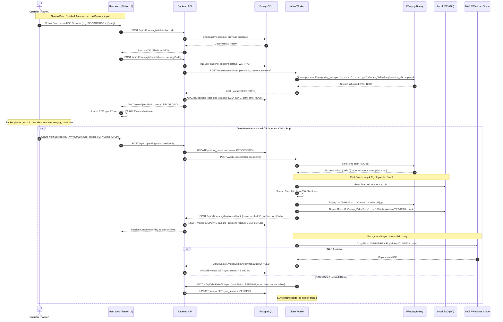
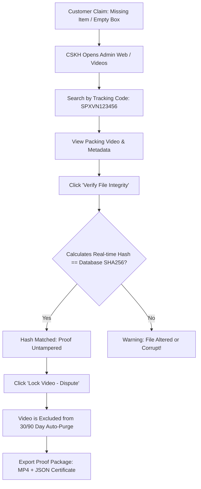

# PACKING VIDEO PROOF - DETAILED PACKING & RECORDING LIFECYCLE

> **Design draft:** Read [BASELINE.md](BASELINE.md) first. Examples below require alignment with its open contracts and acceptance gates before implementation; they are not validated production configurations.

> **Document Version:** 1.0.0  
> **Topic:** Packing Station Operational Flows, Barcode Handling & Fail-Safe Recording Pipeline

---

## 1. End-to-End Operational Sequence



---

## 2. Barcode Scanning & Debounce Architecture

### 2.1. USB HID Emulation
The hardware barcode scanner acts as a standard USB Keyboard device. It emits rapid character keystrokes followed by an automatic `Enter` (Carriage Return `\r` or Line Feed `\n`).

### 2.2. Scanner Interceptor Algorithm (Frontend)
```typescript
// Auto-focus persistence: Ensures keyboard input is never lost if operator clicks off-screen
let barcodeBuffer = "";
let lastKeystrokeTime = 0;
const SCAN_TIMEOUT_MS = 50; // Hardware scanners fire characters within 5-20ms of each other

window.addEventListener("keydown", (e) => {
  const now = Date.now();
  
  if (e.key === "Enter") {
    if (barcodeBuffer.trim().length >= 6) {
      handleScannedBarcode(barcodeBuffer.trim());
      barcodeBuffer = "";
    }
    return;
  }

  // If elapsed time between keys is large, reset buffer (user typed manually)
  if (now - lastKeystrokeTime > SCAN_TIMEOUT_MS && barcodeBuffer.length > 0) {
    barcodeBuffer = "";
  }

  if (e.key.length === 1) {
    barcodeBuffer += e.key;
    lastKeystrokeTime = now;
  }
});
```

### 2.3. Supported Barcode Formats & Regex Rules
| Platform / Carrier | Sample Format | Validation Regular Expression |
| :--- | :--- | :--- |
| **SPX (Shopee Express)** | `SPXVN0458892182B` | `^SPXVN[0-9A-Z]{9,15}$` |
| **TikTok Shop** | `TTWN01928381928` | `^TT[A-Z0-9]{10,20}$` |
| **Lazada (LEX)** | `LXRP-098234812` | `^(LX|LEX)[A-Z0-9\-]{8,20}$` |
| **Giao Hàng Nhanh (GHN)** | `GA63A7K2` | `^[A-Z0-9]{8,15}$` |
| **Giao Hàng Tiết Kiệm (GHTK)** | `S12345678.BO.293` | `^S[0-9]{7,10}(\.[A-Z0-9]+)*$` |
| **Viettel Post** | `1982736458` | `^[0-9]{10,14}$` |
| **J&T Express** | `841029384756` | `^(84|66|88)[0-9]{10,12}$` |
| **Generic / Internal Code128** | `ORD-20261003-91` | `^[A-Za-z0-9\-_]{6,32}$` |

---

## 3. Conflict Prevention & Anti-Mistake Matrix

To prevent operator error in fast-paced warehouse environments, the system strictly enforces the following decision matrix:

| Incoming Scan Event | System State | System Action & UI Behavior |
| :--- | :--- | :--- |
| **Valid Code** | Station `READY` (No active record) | Automatically starts recording. UI turns Red. Timer starts. Audio Chime: `scan-success.mp3`. |
| **Duplicate Code (Already recorded today)** | Station `READY` | **Halt.** Display Yellow Warning Modal: *"Mã vận đơn này đã được quay lúc 09:15 bởi packer02. Bạn có muốn quay lại không?"*. Requires explicit click or `[F4]` override. |
| **Same Code Scanned Again** | Station `RECORDING` (Current Code) | **Ignore.** Treat as double-tap/stray scan. Do not restart or interrupt current session. |
| **New / Different Code Scanned** | Station `RECORDING` | **Interrupt Guard Modal:** <br>• Display loud prompt: <br> *"Đang quay đơn: SPXVN111111"* <br> *"Vừa quét đơn mới: SPXVN222222"* <br>• Choice A: **Hoàn thành đơn cũ & Bắt đầu đơn mới** (`[Enter]`) <br>• Choice B: **Hủy mã vừa quét & Tiếp tục quay đơn cũ** (`[Esc]`) |
| **Invalid Format / Noise** | Any State | Buzzer: `warning.mp3`. Red banner: *"Mã không hợp lệ"*. Input field automatically cleared and re-focused. |
| **Rapid Double Scan (< 500ms)** | Any State | Debounce layer suppresses the second event. |

---

## 4. Video Recording & Storage Pipeline (Zero Data Loss)

### 4.1. Rules of Storage Integrity
1. **Never write to network paths over RTSP/FFmpeg:** All active streams write to high-speed local NVMe/SSD partition `D:\PackingVideoTemp`.
2. **Atomic Move:** Once FFmpeg exits cleanly, the file is moved atomically on the same filesystem to `D:\PackingVideo\YYYY\MM\DD\{filename}.mp4`.
3. **Cryptographic Sealing:** SHA-256 hash is calculated directly from the finalized local file before network sync begins.
4. **Resilient Background Sync:**
   - Worker background worker queues the file for Windows Share transfer (`\\SERVER\PackingVideo\...`).
   - If NAS network connection drops, video remains safe on local disk.
   - Sync daemon retries using exponential backoff (15s, 30s, 60s, 300s).
   - Video record in database clearly reflects `LOCAL` vs `PENDING` vs `SYNCED`.

### 4.2. File Naming Standard
```text
Template: {tracking_code}_{station}_{timestamp}.mp4
Example:  SPXVN123456_PACK01_20261003_163012.mp4
```
- `tracking_code`: Sanitized tracking number (alphanumeric and dashes only).
- `station`: Unique station code (e.g., `PACK01`).
- `timestamp`: UTC or Warehouse Local `YYYYMMDD_HHMMSS`.

---

## 5. Dispute & Forensic Proof Workflow


