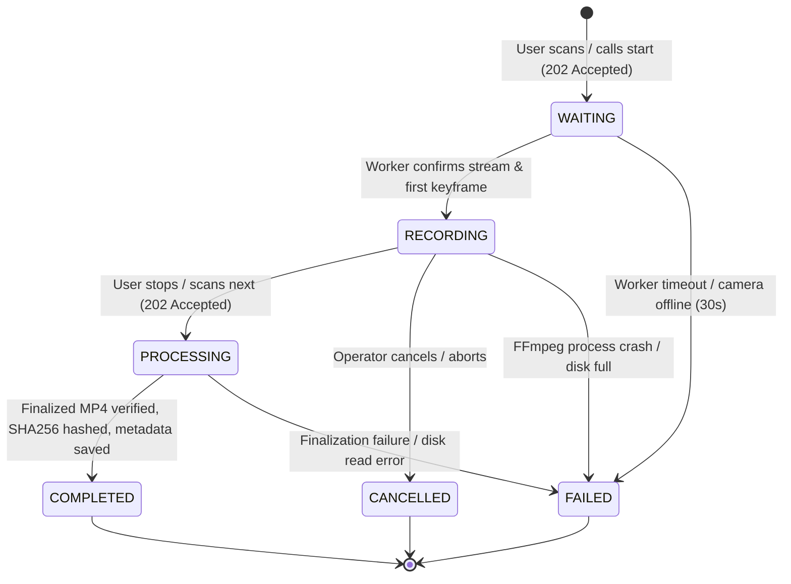

# PACKING VIDEO PROOF - SYSTEM ARCHITECTURE SPECIFICATION

> **Document Version:** 2.0.0 (Updated to Baseline Alignment)  
> **Status:** Architecture Baseline Specification  
> **Scope:** On-Premises LAN-First Packing Proof System

---

## 1. Executive Summary & Design Principles

**PACKING VIDEO PROOF** is an enterprise-grade, fail-safe video recording and forensic audit system designed for warehouse fulfillment hubs, 3PL providers, and e-commerce operators (Shopee, TikTok Shop, Lazada).

### Core Architectural Principles

1. **LAN-First Sovereignty (Zero Cloud Dependency):**
   - Core fulfillment operations (barcode scanning, camera stream ingestion, local storage, verification) function with zero external internet connectivity.
   - Server and station communication occurs strictly over local LAN infrastructure.
2. **Fail-Safe Video Ingestion Pipeline (Never Record Directly to Network Shares):**
   - Active recordings **never** stream directly to SMB/NAS storage due to transient network latency, SMB locks, and packet loss risks.
   $$\text{Camera} \xrightarrow{\text{RTSP/UVC}} \text{Worker Process} \xrightarrow{\text{Direct I/O}} \text{Local SSD Temp (fMP4)} \xrightarrow{\text{Finalize + SHA256}} \text{Local Primary Archive} \xrightarrow{\text{Async Verified Queue}} \text{NAS / SMB Share}$$
3. **Container Crash-Resilience (Fragmented MP4 Ingestion):**
   - Standard MP4 stores its metadata index (`moov` atom) at the end of the file. Sudden power cuts or OS crashes destroy unfinalized MP4s.
   - The ingestion pipeline records to **Fragmented MP4 (fMP4)** (`empty_moov+default_base_moof+frag_keyframe`). Even if power fails mid-recording, all frames up to the last keyframe are preserved and playable without corruption.
   - The finalization step remuxes the file to standard web-optimized MP4 (`+faststart`).
4. **Strict Concurrency Protection & Single Active Session Rule:**
   - One packing station and one camera can execute **at most one active recording session** at any time across the entire database.
   - Guaranteed by PostgreSQL conditional unique indexes and transactional locks, not just frontend debounce.
5. **Decoupled Architecture & Role Boundaries:**
   - **Admin Web:** Management, configuration, audit, video search (no direct DB or filesystem access).
   - **User Web:** Scanning, session status display, operator triggers (no local recording logic).
   - **Backend API:** Central business authority, RBAC, outbox coordinator, metadata manager.
   - **Video Worker:** Host-level camera driver, FFmpeg supervisor, local SSD manager, NAS sync worker.

---

## 2. High-Level System Architecture Diagram

```
+----------------------------------------------------------------------------------------------------+
|                                    PACKING VIDEO PROOF WAREHOUSE LAN                                |
+----------------------------------------------------------------------------------------------------+
|                                                                                                    |
|    +-----------------------------+                           +--------------------------------+     |
|    |      ADMIN WEB (Vite/React) |                           |     USER WEB (Vite/React)      |     |
|    |  - Warehouse/Station Config |                           |  - Packing Station Screen      |     |
|    |  - Video Search & Proof     |                           |  - USB Scanner (HID Keyboard)  |     |
|    |  - Retention & Dispute Lock |                           |  - Giant State & Timer (2m)    |     |
|    +--------------+--------------+                           +---------------+----------------+     |
|                   |                                                          |                      |
|                   | HTTPS (REST API / JWT)                                   | HTTPS / WSS          |
|                   v                                                          v                      |
|    +------------------------------------------------------------------------------------------+     |
|    |                             BACKEND API SERVER (Fastify + TypeScript)                     |     |
|    |  - Multi-Warehouse RBAC (Argon2 / JWT)       - Barcode Validation Engine                 |     |
|    |  - Command Outbox & Idempotency Router       - Session State Machine (OCC Versioning)    |     |
|    |  - Worker Dispatcher Gateway (WSS)           - Video Streaming Range Proxy (HTTP 206)    |     |
|    +----------------------------+---------------------------------------------+---------------+     |
|                                 |                                             |                     |
|            PostgreSQL Connection|Pool                                      WSS|Reverse Tunnel       |
|            (Conditional Indexes)|                                  (Auth Token|& Heartbeat 10s)     |
|                                 v                                             v                     |
|    +----------------------------+---------+          +------------------------+---------------+     |
|    |          POSTGRESQL 16               |          |       VIDEO WORKER (STATION PC)        |     |
|    |  - Business, Warehouses, Stations    |          |  - Node.js Daemon (Local Loopback 4005)|     |
|    |  - Packing Sessions (Conditional UQ) |          |  - Persistent WSS Client to Backend    |     |
|    |  - Video Metadata & SHA-256 Hashes   |          |  - FFmpeg Supervisor (fMP4 Ingestion)  |     |
|    |  - Command Outbox & Audit Logs       |          |  - SHA-256 Hasher & Local File Manager |     |
|    +--------------------------------------+          |  - NAS Copy Queue (Retry & Backoff)    |     |
|                                                      +-----+--------------------+-------------+     |
|                                                            |                    |                   |
|                                     RTSP TCP / DirectShow  |                    | Atomic Move & SMB |
|                                                            v                    v                   |
|                                                +-----------+--+     +-----------+-------------+     |
|                                                | CAMERAS      |     | STORAGE SUB-SYSTEM      |     |
|                                                | - RTSP H.264 |     | 1. Local Temp (D:\Temp) |     |
|                                                | - USB Webcams|     | 2. Local Final (D:\Vid) |     |
|                                                +--------------+     | 3. NAS Share (\\NAS\Vid)|     |
|                                                                     +-------------------------+     |
+----------------------------------------------------------------------------------------------------+
```

---

## 3. Communication Topology & Network Contracts

### 3.1. Topology Architecture
In enterprise warehouse deployments, the system topology consists of:
1. **Central Server Node (`192.168.1.10`):** Runs PostgreSQL, Backend API, and serves frontend static bundles via Nginx reverse proxy.
2. **Station Packing PCs (`192.168.1.51...70`):** Windows 10/11 PCs with USB Barcode Scanners, connected to USB Webcams or local PoE RTSP cameras.
3. **NAS / Storage Server (`192.168.1.15`):** High-capacity redundant array hosting Windows SMB Share `\\SERVER\PackingVideo`.

### 3.2. Worker-to-Backend Reverse Tunnel (Agent Pattern)
To eliminate fragile inbound routing to station PCs (DHCP IP changes, Windows firewall blocks, NAT):
- Each Video Worker initializes a persistent **WebSocket connection** (`wss://<server-ip>:4000/ws/worker`) upon boot.
- The connection is authenticated using a per-station cryptographically generated `X-Worker-Token`.
- **Backend-to-Worker Commands:** The Backend dispatches commands (`START_RECORD`, `STOP_RECORD`, `CANCEL_RECORD`) over this established tunnel.
- **Worker-to-Backend Telemetry:** The Worker streams heartbeats every 10 seconds (`ONLINE`, CPU, active session, disk space free) and pushes real-time recording milestones (`STREAM_READY`, `FIRST_KEYFRAME`, `FINALIZED`, `SYNC_STATUS`).
- **Local Fallback:** In single-PC / standalone kiosk setups, loopback HTTP (`http://127.0.0.1:4005`) is also supported.

### 3.3. Remote Video Playback Architecture (Local vs. NAS)
When an administrator in Admin Web requests to view a video:
- **Case 1: Video is `SYNCED` to NAS:** Backend API streams the file directly from the NAS mount path using HTTP 206 Partial Content range requests.
- **Case 2: Video is still `LOCAL` (pending NAS sync):** Backend API delegates the stream by issuing an authenticated internal reverse-proxy request to the Station Worker's media streaming port, or fetches the file chunk on demand. The User Web never accesses `D:\` directly.

---

## 4. State Machine & Idempotency Rules

### 4.1. Formal Session State Transitions


### 4.2. Concurrency & Idempotency Rules
1. **Idempotency Key Enforcement:** Every mutation (`start`, `stop`, `cancel`) requires an `Idempotency-Key` header (UUIDv4).
   - If an operation is received with an existing key and identical payload: Backend returns the cached session response.
   - If an operation is received with an existing key but conflicting payload: Backend returns `409 Conflict` (`IDEMPOTENCY_PAYLOAD_MISMATCH`).
2. **Single Active Session Constraint:**
   - Enforced at the DB level via PostgreSQL partial unique index:
     `CREATE UNIQUE INDEX uq_active_station_session ON packing_sessions (station_id) WHERE status IN ('WAITING', 'RECORDING', 'PROCESSING');`
   - Any parallel race attempt to open a second session on the same station instantly fails with a DB unique constraint violation (`409 Conflict`).
3. **Optimistic Concurrency Control (OCC):**
   - Tables `packing_sessions` and `videos` contain an integer `version` column. State transitions increment `version` and check `WHERE id = :id AND version = :currentVersion`.
