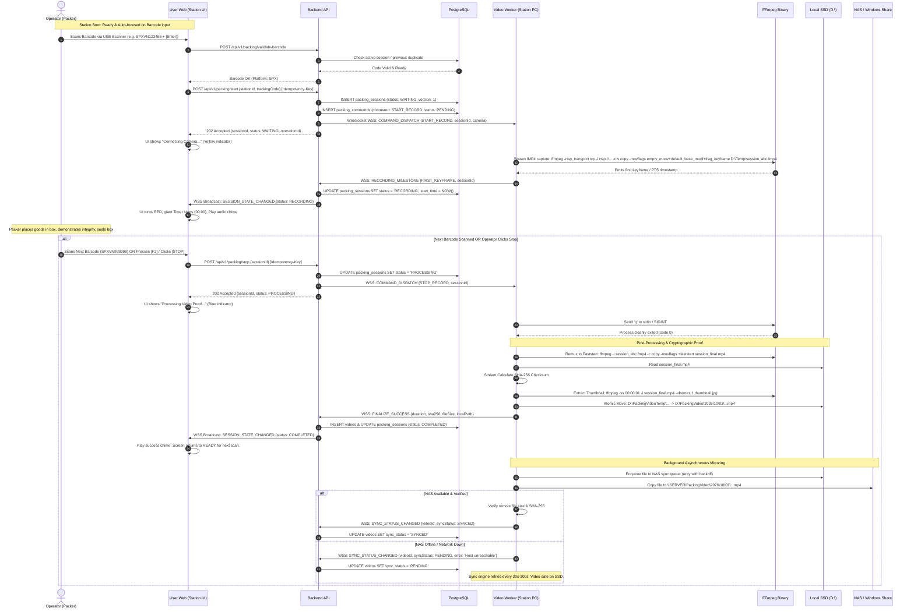

# PACKING VIDEO PROOF - DETAILED PACKING & RECORDING LIFECYCLE

> **Document Version:** 2.1.0 (Detailed Operational Flows with Error & Test Specifications)  
> **Topic:** Packing Station Operational Flows, Barcode Handling & Fail-Safe Recording Pipeline

---

## 1. End-to-End Operational Sequence



---

## 2. Chi Tiết Các Luồng Nghiệp Vụ Chính

---

### Luồng 1: Bắt đầu phiên quay đóng gói (Start Recording Flow)

- **Đầu vào (Inputs):**
  - `stationId`: UUID của trạm đóng gói.
  - `trackingCode`: Mã vận đơn đã được chuẩn hóa (ví dụ: `SPXVN0458892182B`).
  - `orderCode`: Mã đơn hàng nội bộ (tùy chọn hoặc tự sinh theo tracking code).
  - `platform`: Sàn thương mại điện tử / Đơn vị vận chuyển (`SPX`, `TIKTOK`, `LAZADA`, `GHN`, `GHTK`, `VIETTEL_POST`, `JT`, `OTHER`).
  - `Idempotency-Key`: UUIDv4 định danh lệnh từ client.
  - `forceOverridePrevious`: Boolean (mặc định: `false`).
- **Điều kiện tiên quyết (Prerequisites):**
  - Operator đã đăng nhập, JWT hợp lệ và `user.warehouse_id === station.warehouse_id`.
  - Station đang ở trạng thái `ONLINE` (Worker có heartbeat $< 30$s).
  - Không có phiên nào trên trạm hoặc camera đang ở trạng thái `WAITING`, `RECORDING`, hoặc `PROCESSING` (bảo vệ bởi `uq_active_station_session`).
  - Dung lượng trống ổ SSD `D:\PackingVideoTemp` $\ge 2$ GB.
- **Kết quả mong đợi (Expected Results):**
  - Database tạo `packing_sessions` với trạng thái `WAITING`.
  - Backend trả về `202 Accepted` với payload `{sessionId, operationId, status: "WAITING"}`.
  - Video Worker nhận lệnh qua WebSocket, khởi chạy tiến trình FFmpeg capture `fMP4`.
  - Ngay khi nhận được keyframe đầu tiên, Worker gửi `RECORDING_MILESTONE`, Backend chuyển trạng thái sang `RECORDING`, broadcast WebSocket tới User Web. Màn hình trạm chuyển sang màu ĐỎ, bộ đếm giờ (Timer) bắt đầu chạy từ `00:00`.
- **Nhánh lỗi (Failure Branches):**
  1. *Lỗi xung đột phiên đang chạy:* Trạm đã có phiên đang quay $\rightarrow$ Trả `409 Conflict` (`ACTIVE_SESSION_EXISTS`).
  2. *Lỗi trùng mã đã đóng hôm nay:* Mã vận đơn đã có video `COMPLETED` trong ca $\rightarrow$ Trả `409 Conflict` (`BARCODE_PREVIOUSLY_PACKED`).
  3. *Lỗi Worker Offline:* Worker không gửi heartbeat $> 30$s $\rightarrow$ Trả `503 Service Unavailable` (`WORKER_OFFLINE`).
  4. *Lỗi Camera Timeout:* Sau 15 giây từ khi nhận lệnh, FFmpeg không xuất được keyframe (camera mất nguồn/đứt cáp mạng) $\rightarrow$ Backend cập nhật session thành `FAILED`, gửi cảnh báo `CAMERA_INIT_TIMEOUT` tới UI.
- **Cách phục hồi (Recovery Mechanisms):**
  - Nếu gặp timeout mạng giữa UI và Backend: UI sử dụng lại đúng `Idempotency-Key` để retry. Backend trả lại đúng bản ghi session đã tạo mà không tạo thêm phiên mới.
  - Nếu camera timeout: Hủy tiến trình FFmpeg treo, trả trạm về trạng thái `READY` để kiểm tra dây camera.
- **Tiêu chí kiểm thử (Acceptance Test Criteria):**
  - [TC-START-01] Gửi 2 request Start đồng thời với 2 tracking code khác nhau trên cùng 1 station $\rightarrow$ Đúng 1 request thành công (`202 Accepted`), request thứ hai nhận `409 Conflict`.
  - [TC-START-02] Gửi lại request Start với cùng `Idempotency-Key` và payload $\rightarrow$ Nhận lại kết quả của phiên cũ với mã HTTP tương ứng.
  - [TC-START-03] Ngắt kết nối camera và bấm Start $\rightarrow$ Sau 15 giây session chuyển `FAILED`, UI hiển thị thông báo lỗi rõ ràng.

---

### Luồng 2: Dừng quay & Hoàn tất đóng gói (Stop & Finalize Recording Flow)

- **Đầu vào (Inputs):**
  - `sessionId`: UUID của phiên đóng gói đang ở trạng thái `RECORDING`.
  - `Idempotency-Key`: UUIDv4.
- **Điều kiện tiên quyết (Prerequisites):**
  - Phiên đóng gói tồn tại và đang ở trạng thái `RECORDING`.
  - Người thực hiện có quyền thao tác trên trạm sở tại.
- **Kết quả mong đợi (Expected Results):**
  - Backend cập nhật trạng thái session sang `PROCESSING`, trả `202 Accepted` cho UI.
  - Video Worker gửi lệnh `q` vào stdin của FFmpeg để kết thúc luồng.
  - Worker remux tệp `.fmp4` tạm sang tệp chuẩn `.mp4` kèm cờ `-movflags +faststart`.
  - Worker tính toán trực tiếp mã băm SHA-256 dạng stream.
  - Worker trích xuất ảnh đại diện JPEG tại giây 00:00:01.
  - Tệp video được di chuyển nguyên tử (atomic move) sang thư mục lưu trữ cục bộ: `D:\PackingVideo\YYYY\MM\DD\{filename}.mp4`.
  - Worker gửi `FINALIZE_SUCCESS` về Backend.
  - Backend ghi bản ghi vào bảng `videos`, cập nhật session sang `COMPLETED`, broadcast qua WebSocket. UI phát âm báo thành công và quay lại trạng thái `READY`.
- **Nhánh lỗi (Failure Branches):**
  1. *Lỗi FFmpeg không dừng sau lệnh 'q':* Sau 3 giây FFmpeg vẫn chạy $\rightarrow$ Worker cưỡng chế gửi `SIGINT` (Ctrl+C).
  2. *Lỗi thời lượng video quá ngắn ($< 3$ giây):* Worker cảnh báo `VIDEO_DURATION_TOO_SHORT`, vẫn lưu video nhưng đánh dấu cờ cảnh báo trên giao diện quản trị.
  3. *Lỗi đầy ổ cứng trong lúc finalize:* Ổ cứng không đủ dung lượng để remux $\rightarrow$ Báo lỗi `DISK_FULL`, giữ nguyên tệp `.fmp4` gốc, chuyển session sang `FAILED` kèm đường dẫn tệp cứu hộ.
- **Cách phục hồi (Recovery Mechanisms):**
  - Luôn bảo tồn tệp `.fmp4` gốc tại `D:\PackingVideoTemp` cho đến khi tệp `.mp4` hoàn chỉnh đã được kiểm tra tính toàn vẹn (dung lượng $>0$ và `ffprobe` hợp lệ).
- **Tiêu chí kiểm thử (Acceptance Test Criteria):**
  - [TC-STOP-01] Video tạo ra phải phát được ngay lập tức trên các trình duyệt Chrome, Edge, Firefox mà không cần tải toàn bộ tệp (kiểm tra `moov atom` nằm ở đầu tệp).
  - [TC-STOP-02] Mã SHA-256 lưu trong bảng `videos` phải trùng khớp 100% với lệnh `Get-FileHash -Algorithm SHA256` của Windows PowerShell trên tệp cục bộ.

---

### Luồng 3: Quét mã vạch USB HID & Chống quét nhầm (Barcode Scan & Anti-Mistake Flow)

- **Đầu vào (Inputs):**
  - Chuỗi ký tự từ máy quét USB (hoạt động như bàn phím HID) kết thúc bằng phím `Enter` (`\r` hoặc `\n`).
- **Điều kiện tiên quyết (Prerequisites):**
  - Màn hình User Web đang mở, listener bàn phím toàn cục (global keydown listener) đang hoạt động.
- **Kết quả mong đợi (Expected Results):**
  - Hệ thống tự động gom các ký tự có khoảng cách gõ $< 50$ms thành mã vạch hoàn chỉnh.
  - Kiểm tra regex nhận dạng đúng sàn/hãng vận chuyển.
  - Khi trạm ở trạng thái `READY`: Tự động kích hoạt Luồng 1 (Start Recording) không cần dùng chuột.
- **Nhánh lỗi & Cơ chế va chạm:**
  1. *Trường hợp quét mã mới khi đang quay đơn cũ:*
     - Hệ thống **không** tự ý hủy đơn cũ hay chuyển đơn.
     - Kích hoạt cửa sổ cảnh báo Modal lớn trên màn hình:
       - *"Đang quay đơn: SPXVN111111"*
       - *"Vừa quét đơn mới: SPXVN222222"*
       - Lựa chọn 1: Bấm `[Enter]` $\rightarrow$ Hoàn thành đơn cũ và tự động bắt đầu đơn mới.
       - Lựa chọn 2: Bấm `[Esc]` $\rightarrow$ Hủy mã vừa quét, tiếp tục quay đơn cũ bình thường.
  2. *Trường hợp quét trùng mã đang quay:* Hệ thống coi là nhấn nhầm/quét đúp và bỏ qua, không làm gián đoạn phiên.
  3. *Trường hợp mã không đúng định dạng:* Phát âm thanh cảnh báo lỗi `warning.mp3`, hiển thị thông báo đỏ và tự động bôi đen ô nhập để quét lại.
- **Tiêu chí kiểm thử (Acceptance Test Criteria):**
  - [TC-SCAN-01] Quét 1 mã vạch mới trong khi bộ đếm giờ đang chạy $\rightarrow$ Modal cảnh báo xuất hiện ngay lập tức, video đang quay không bị dừng cho đến khi người dùng bấm xác nhận.

---

### Luồng 4: Đồng bộ NAS & Khả năng chịu lỗi mất mạng (NAS Mirroring & Offline Resilience Flow)

- **Đầu vào (Inputs):**
  - Tệp video đã hoàn tất lưu trữ cục bộ: `D:\PackingVideo\YYYY\MM\DD\{filename}.mp4`.
  - Bản ghi video trong database có trạng thái `sync_status = 'PENDING'`.
- **Điều kiện tiên quyết (Prerequisites):**
  - Tệp cục bộ đã tồn tại và đã tính xong SHA-256.
  - Cấu hình lưu trữ NAS (`storage_configs`) đang được kích hoạt (`enabled = true`).
- **Kết quả mong đợi (Expected Results):**
  - Hàng đợi đồng bộ của Worker thực hiện sao chép tệp sang đường dẫn mạng tạm thời trên NAS: `\\SERVER\PackingVideo\YYYY\MM\DD\{filename}.mp4.tmp`.
  - Sau khi copy xong, kiểm tra dung lượng tệp trên NAS.
  - Đổi tên tệp trên NAS thành `{filename}.mp4`.
  - Cập nhật database: `sync_status = 'SYNCED'`, `nas_path = '\\SERVER\PackingVideo\...'`.
- **Nhánh lỗi (Failure Branches):**
  1. *NAS mất kết nối / Đứt dây mạng LAN:*
     - Lệnh copy thất bại với lỗi I/O.
     - Worker **tuyệt đối không xóa bản local**.
     - Đánh dấu trạng thái `sync_status = 'PENDING'`, ghi nhận `sync_error`.
     - Đưa công việc vào hàng đợi retry với thuật toán exponential backoff (15s, 30s, 60s, 300s).
- **Cách phục hồi (Recovery Mechanisms):**
  - Khi NAS khôi phục kết nối, tiến trình nền tự động tiếp tục sao chép các tệp đang ở trạng thái `PENDING` theo thứ tự `created_at ASC`. Hoạt động đóng gói tại các trạm không bao giờ bị đình trệ vì NAS lỗi.
- **Tiêu chí kiểm thử (Acceptance Test Criteria):**
  - [TC-NAS-01] Giả lập ngắt card mạng nối với NAS trong 10 phút, thực hiện đóng 5 đơn hàng $\rightarrow$ Cả 5 đơn hàng đều hoàn tất thành công trên máy trạm với `sync_status = 'PENDING'`, video mở xem tại chỗ bình thường.
  - [TC-NAS-02] Bật lại card mạng NAS $\rightarrow$ Trong vòng 5 phút, toàn bộ 5 video tự động đồng bộ sang NAS và cập nhật trạng thái thành `SYNCED`.

---

### Luồng 5: Phục hồi sau sự cố máy trạm / Tắt nguồn đột ngột (Crash & Power-Cut Recovery Flow)

- **Đầu vào (Inputs):**
  - Các tệp dở dang nằm trong `D:\PackingVideoTemp` mang đuôi `.fmp4` hoặc `.tmp.mp4` sau khi máy trạm khởi động lại.
- **Điều kiện tiên quyết (Prerequisites):**
  - Dịch vụ Video Worker khởi động cùng Windows (chạy dưới dạng Windows Service).
- **Kết quả mong đợi (Expected Results):**
  - Worker quét toàn bộ thư mục `D:\PackingVideoTemp`.
  - Với mỗi tệp có dung lượng $> 100$ KB: Gọi lệnh `ffprobe` kiểm tra luồng video.
  - Do được ghi bằng cấu trúc `fMP4`, toàn bộ các phân đoạn trước thời điểm mất điện đều còn nguyên vẹn.
  - Worker thực hiện cứu hộ bằng lệnh:
    ```bash
    ffmpeg -err_detect ignore_err -i partial.fmp4 -c copy -movflags +faststart partial_recovered.mp4
    ```
  - Tính SHA-256 cho video cứu hộ, chuyển sang thư mục lưu trữ và gửi thông báo `WORKER_CRASH_RECOVERED` về Backend.
  - Backend cập nhật phiên tương ứng thành `FAILED_WITH_PARTIAL_PROOF` để vẫn lưu giữ bằng chứng đóng hàng cho shop.
- **Tiêu chí kiểm thử (Acceptance Test Criteria):**
  - [TC-CRASH-01] Dùng Task Manager cưỡng chế Kill tiến trình FFmpeg (`taskkill /F /IM ffmpeg.exe`) khi đang quay ở giây thứ 30 $\rightarrow$ Khởi động lại Worker, hệ thống phải trích xuất được tệp video hoàn chỉnh chứa đúng 30 giây đã quay và phát lại bình thường.

---

### Luồng 6: Quản lý tranh chấp khiếu nại & Quét dọn Retention (Dispute Lock & Retention Purge Flow)

- **Đầu vào (Inputs):**
  - Tác vụ dọn dẹp định kỳ (Daily Retention Cron) chạy lúc 02:00 sáng.
  - Hoặc thao tác của CSKH khóa bằng chứng qua API: `PATCH /api/v1/videos/:id/dispute`.
- **Điều kiện tiên quyết (Prerequisites):**
  - Chỉ xem xét xóa các video thỏa mãn:
    $$\text{created\_at} < (\text{NOW}() - \text{retention\_days}) \land \text{is\_locked} = \text{FALSE} \land \text{dispute\_status} = \text{'NORMAL'} \land \text{sync\_status} = \text{'SYNCED'}$$
- **Kết quả mong đợi (Expected Results):**
  - Khi CSKH phát hiện đơn hàng bị khiếu nại (khách báo nhận thiếu hàng): Bấm nút "Khóa tranh chấp" $\rightarrow$ Database cập nhật `is_locked = TRUE`, `dispute_status = 'DISPUTE'`, `locked_by = userId`, `lock_reason = "Khách khiếu nại thiếu hàng"`. Video này vĩnh viễn không bị xóa bởi retention cron cho đến khi được mở khóa thủ công.
  - Khi Retention Cron chạy:
    - Mở transaction PostgreSQL với lệnh:
      ```sql
      SELECT id, local_path, nas_path FROM videos 
      WHERE created_at < NOW() - INTERVAL '90 days'
        AND is_locked = FALSE 
        AND dispute_status = 'NORMAL'
        AND sync_status = 'SYNCED'
      FOR UPDATE SKIP LOCKED;
      ```
    - Thực hiện xóa tệp video trên đĩa, giữ nguyên dòng metadata trong bảng `videos` (đánh dấu `purged_at = NOW()`).
- **Cách phục hồi & Chống chạy đua (Race Condition Prevention):**
  - Cơ chế `FOR UPDATE SKIP LOCKED` đảm bảo nếu CSKH đang thao tác trên video đúng thời điểm cron chạy, dòng đó sẽ bị khóa và cron sẽ bỏ qua, tuyệt đối không có rủi ro xóa nhầm video đang xử lý khiếu nại.
- **Tiêu chí kiểm thử (Acceptance Test Criteria):**
  - [TC-RET-01] Đánh dấu 1 video cũ quá hạn với `is_locked = TRUE`. Chạy retention cron $\rightarrow$ Tệp video trên ổ đĩa và NAS vẫn còn nguyên vẹn 100%.
